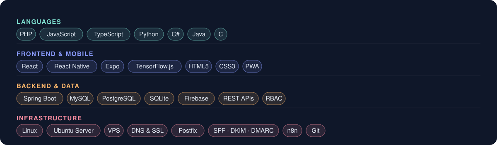
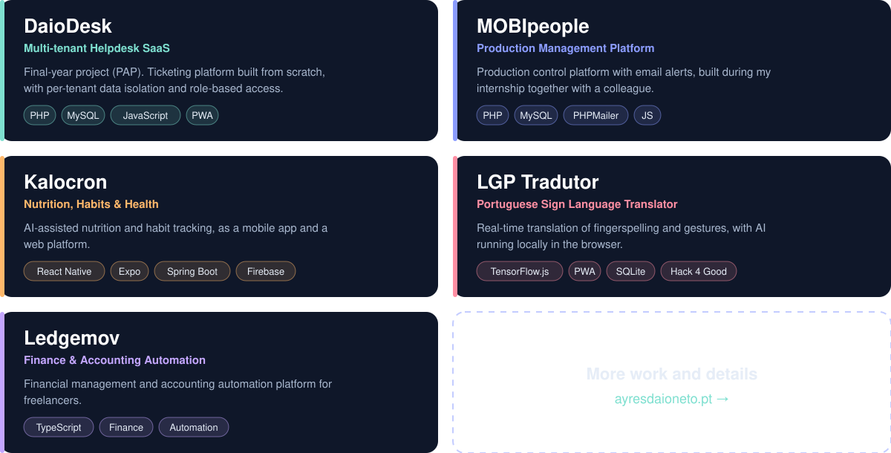
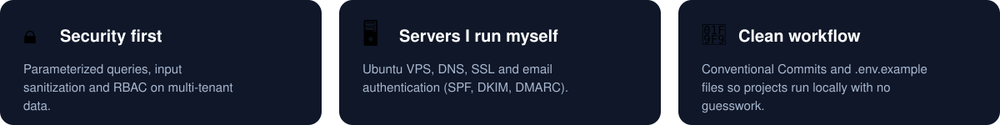

  
  
  

I'm a full-stack developer from Coimbra, Portugal. I build web platforms and mobile apps, and I'm comfortable on the Linux server side too, from database design to deployment. I like projects that solve real problems: helpdesk, production control, health tracking, finance and accessibility.

## 🛠️ Tech Stack

## 🚀 Featured Projects

**🤟 LGP Tradutor** runs entirely in the browser with TensorFlow.js, so no camera data leaves the user's device: [Desktop demo](https://lgp-tradutor.vercel.app/) · [Mobile PWA](https://lgp-tradutor.vercel.app/mobile/) · [Source code](https://github.com/ayresdaio/Hack-4-Good)

## 🔒 How I Work

## 🤝 Let's Connect

I'm open to developer opportunities and, soon, to small freelance projects: web platforms, automation, and server and email setup.

  📫 <a href="mailto:ayresdaioneto@gmail.com">ayresdaioneto@gmail.com</a> · <a href="https://ayresdaioneto.pt">ayresdaioneto.pt</a> · <a href="https://www.linkedin.com/in/ayres-daio-neto">LinkedIn</a>

